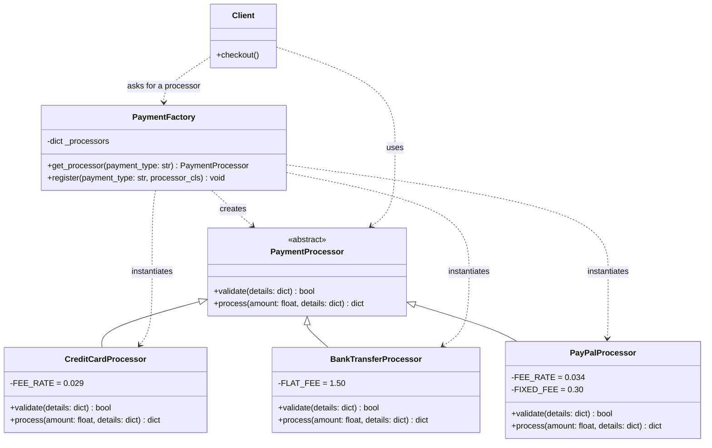

# Factory Pattern - Payment System Refactoring

## Problem
The legacy `process_payment()` function uses a long `if/elif` chain. Adding a new
payment method (Apple Pay, Crypto, regional transfers...) means modifying the core
function, which violates the **Open/Closed Principle** and risks breaking existing methods.

## Solution
- **`PaymentProcessor`** (ABC): the blueprint with `validate()` and `process()`
- **Concrete processors**: `CreditCardProcessor`, `BankTransferProcessor`, `PayPalProcessor`,
  each owning its own validation and fee logic
- **`PaymentFactory`**: maps a string to a processor class using a dictionary

Adding a new method = create a new class + register it. No existing code is modified.

## UML Class Diagram



## Run

```
python payment_factory.py
python -m unittest test_payment_factory.py -v
```

## Usage

```python
factory = PaymentFactory()
processor = factory.get_processor("credit_card")
result = processor.process(100.0, {"card_number": "1234567890123456", "cvv": "123"})
```

## Adding a new payment method

```python
class ApplePayProcessor(PaymentProcessor):
    ...

factory.register("apple_pay", ApplePayProcessor)
```
